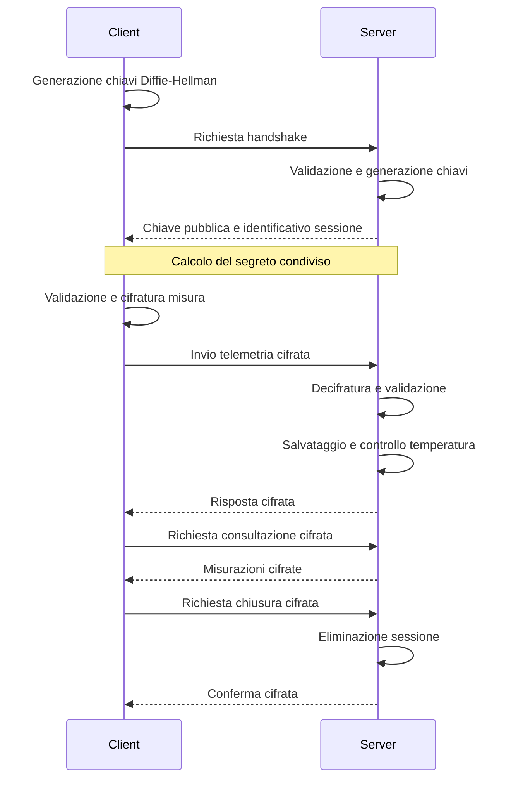

# FrigoTrack – Sistema di telemetria sicura

## Descrizione del progetto

FrigoTrack è un'applicazione Client-Server sviluppata in C# con .NET 8, progettata per simulare il monitoraggio delle temperature durante il trasporto di prodotti alimentari, farmaceutici e surgelati.

Il sistema permette di raccogliere, trasmettere e memorizzare le misurazioni dei sensori, garantendo la validazione dei dati e la protezione dei messaggi attraverso tecniche crittografiche.

Il Client simula i sensori e comunica con il Server, che elabora le informazioni ricevute, controlla le temperature e gestisce eventuali allarmi.

## Tecnologie utilizzate

- **C# e .NET 8:** sviluppo delle applicazioni.
- **ASP.NET Core:** realizzazione del Server HTTP.
- **HTTP e JSON:** comunicazione tra Client e Server.
- **Diffie-Hellman:** scambio iniziale del segreto condiviso.
- **AES-GCM:** cifratura e controllo dell'integrità dei messaggi.
- **SHA-256:** derivazione della chiave crittografica.
- **JSON Schema:** validazione dei dati.
- **Visual Studio 2022:** ambiente di sviluppo.

## Struttura del progetto

La soluzione FrigoTrack è composta da due progetti principali.

### Client

Il Client è un'applicazione console che gestisce la simulazione dei sensori, lo scambio delle chiavi, la cifratura dei dati e l'invio delle richieste al Server.

Si occupa inoltre di ricevere le risposte, visualizzare gli allarmi, consultare le misurazioni precedenti e richiedere la chiusura della sessione.

### Server

Il Server è un'applicazione ASP.NET Core che riceve le richieste HTTP, gestisce le sessioni e verifica la validità dei messaggi.

Dopo aver decifrato i dati, salva le misurazioni nel file `misure.json`, controlla le temperature e restituisce le risposte al Client.

### File principali

- `Client.cs`: logica dell'applicazione Client.
- `Program.cs`: configurazione e gestione degli endpoint del Server.
- `DiffieHellman.cs`: gestione dello scambio delle chiavi.
- `Cifratura.cs`: cifratura e decifratura AES-GCM.
- `Validazione.cs`: validazione dei messaggi tramite JSON Schema.
- `misure.json`: archivio delle misurazioni.
- `Schemas` e `schemas`: cartelle contenenti gli schemi JSON.

## Requisiti

Per eseguire il progetto sono necessari Visual Studio 2022, .NET 8 SDK e i pacchetti NuGet utilizzati dalla soluzione.

## Avvio del programma

1. Aprire il file `FrigoTrack.sln` con Visual Studio.
2. Attendere il ripristino dei pacchetti NuGet.
3. Compilare la soluzione.
4. Configurare Server e Client come progetti di avvio multipli, avviando prima il Server.
5. Eseguire la soluzione.

Il Server utilizza l'indirizzo `http://localhost:5000`.

Una volta avviato, il Client esegue automaticamente la simulazione.

## Funzionamento

### Handshake Diffie-Hellman

All'inizio della comunicazione, Client e Server eseguono uno scambio Diffie-Hellman utilizzando un gruppo a 2048 bit.

Entrambi generano una chiave privata e una chiave pubblica. Attraverso lo scambio delle chiavi pubbliche, calcolano indipendentemente lo stesso segreto condiviso.

Il segreto viene utilizzato per ricavare una chiave AES a 256 bit tramite SHA-256.

Il Server crea inoltre un identificativo univoco per la sessione.

### Simulazione dei sensori

Il Client simula tre sensori dedicati al monitoraggio di prodotti farmaceutici, alimentari e surgelati.

Il programma esegue tre cicli di misurazione, introducendo piccole variazioni casuali delle temperature.

Ogni misurazione contiene l'identificativo del sensore, la data e l'ora, la tipologia di merce, la temperatura, l'umidità e il livello della batteria.

### Validazione dei dati

I messaggi vengono controllati mediante JSON Schema, che definisce la struttura e i valori consentiti.

Il Client valida le misurazioni prima dell'invio, mentre il Server effettua ulteriori controlli dopo la decifratura.

I messaggi non conformi vengono rifiutati.

### Cifratura AES-GCM

Le misurazioni vengono cifrate prima di essere trasmesse.

AES-GCM permette di proteggere il contenuto dei messaggi e di verificarne l'integrità attraverso un tag di autenticazione.

Anche le risposte applicative del Server vengono cifrate.

### Controllo delle temperature

Il Server verifica le temperature delle misurazioni ricevute.

Per i prodotti farmaceutici viene controllato l'intervallo compreso tra 2 °C e 8 °C.

Quando la temperatura non rispetta i limiti stabiliti, il Server genera un allarme che viene comunicato al Client.

### Memorizzazione delle misure

Le misurazioni valide vengono salvate nel file `misure.json`.

Questo sistema consente di conservare i dati anche dopo la terminazione del programma.

### Consultazione delle misure

Il Client può richiedere le misurazioni registrate per un determinato sensore in uno specifico intervallo temporale.

Il Server filtra i dati memorizzati e restituisce le informazioni richieste attraverso una risposta cifrata.

### Chiusura della sessione

Al termine della simulazione, il Client invia una richiesta di chiusura.

Il Server elimina la sessione dalla memoria e restituisce una conferma.

Le richieste successive che utilizzano una sessione non più valida vengono rifiutate.

## Endpoint HTTP

| Metodo | Endpoint | Funzione |
|---|---|---|
| POST | `/api/handshake` | Scambio delle chiavi e creazione della sessione |
| POST | `/api/telemetry` | Trasmissione delle misurazioni |
| POST | `/api/readings` | Consultazione dei dati registrati |
| POST | `/api/close` | Chiusura della sessione |

## Diagramma di sequenza

## Test e verifiche

Durante lo sviluppo sono stati verificati:

- Il corretto completamento dell'handshake Diffie-Hellman.
- L'invio e la ricezione delle misurazioni valide.
- Il rifiuto dei dati non conformi al JSON Schema.
- La generazione degli allarmi di temperatura.
- La memorizzazione e la consultazione delle misure.
- La chiusura della sessione.
- Il rifiuto delle richieste effettuate con una sessione chiusa.
- La gestione delle richieste verso endpoint inesistenti.

Restano da verificare separatamente il rifiuto di un messaggio cifrato manomesso e quello di una sessione mai creata.

## Sicurezza e limitazioni

FrigoTrack utilizza Diffie-Hellman per concordare un segreto condiviso e AES-GCM per proteggere la riservatezza e l'integrità dei messaggi.

La validazione JSON Schema permette inoltre di controllare la correttezza dei dati ricevuti.

Il sistema presenta alcune limitazioni:

- Lo scambio Diffie-Hellman non autentica l'identità delle parti.
- La comunicazione HTTP non utilizza TLS.
- Non è prevista una protezione specifica contro gli attacchi di ripetizione.
- Le sessioni vengono mantenute nella memoria del Server.
- I dati sono archiviati in un file JSON anziché in un database.

FrigoTrack è quindi un progetto didattico e non un sistema destinato all'utilizzo in produzione.

## Conclusione

FrigoTrack integra comunicazione Client-Server, crittografia, validazione dei messaggi, gestione delle sessioni e monitoraggio delle temperature.

Il progetto permette di applicare concretamente i concetti di sicurezza informatica e trasmissione dei dati a un sistema di telemetria per la catena del freddo.
